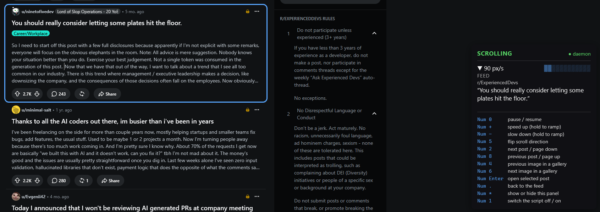
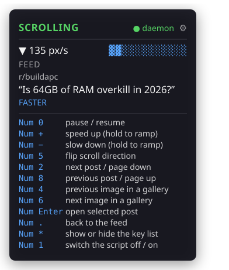

# Reddit Scroller

[](https://github.com/YokoAC/reddit-scroller/actions/workflows/tests.yml)
[](https://github.com/YokoAC/reddit-scroller/actions/workflows/tests.yml)
[](LICENSE)
[](#setup)
[](#browser-support)
[](#browser-support)
[](pyproject.toml)

Auto-scrolls a Reddit feed in your normal browser on a second monitor, driven by
global numpad hotkeys — so you can keep reading while another application, such
as a full-screen game, has focus.

<div align="center">
  
</div>

Two halves:

- A **userscript** that runs inside your real, already-logged-in Firefox or Chrome.
  It owns the scrolling, decides which post is "current", and draws the on-screen
  readout. Any operating system.
- A **Python daemon** that owns the global keyboard hook and hands commands to the
  userscript over `127.0.0.1`. Windows only — it matches keys by Windows scan
  code — and optional, so the rest works without it.

## Setup

**1. The userscript**

1. Install Violentmonkey — for
   [Firefox](https://addons.mozilla.org/firefox/addon/violentmonkey/) or for
   [Chrome](https://chromewebstore.google.com/detail/violentmonkey/jinjaccalgkegednnccohejagnlnfdag).
   Tampermonkey works too; the script uses nothing specific to either.
2. Open the script itself:
   **[reddit-scroller.user.js](https://raw.githubusercontent.com/YokoAC/reddit-scroller/main/userscript/dist/reddit-scroller.user.js)**
   — Violentmonkey recognises the `.user.js` name and offers to install it.
3. Open `https://www.reddit.com`. The HUD appears bottom-right.

That is the whole install, it updates itself, and it is already usable: the
numpad scrolls the feed whenever the browser has focus. No Python, no Node. No
numpad either? [Change the keys](#changing-the-keys).

**2. The daemon** — Windows only, optional, for the case a page cannot cover

A web page only receives keys while it has focus. The daemon hooks the keyboard
globally, so the numpad still works with another application in front. That is
all it adds. It is a Python project, so it needs the code and a way to run it:

1. Install [uv](https://docs.astral.sh/uv/getting-started/installation/), which
   fetches Python and the dependencies for you:

   ```bash
   winget install --id astral-sh.uv
   ```

2. Get the code — `git clone https://github.com/YokoAC/reddit-scroller`, or
   **Code → Download ZIP** on this page and unpack it.

3. From that folder:

   ```bash
   uv sync
   uv run python -m reddit_scroller
   ```

Leave it running; it prints its bindings on start. The HUD's dot turns green
within a few seconds — no reload needed.

What a global keyboard hook does, plainly: it reads only the scan codes it is
bound to; any other key is dropped in `handle_press` before anything is stored,
printed or sent. Nothing is written to disk, nothing leaves `127.0.0.1`, and
nothing is suppressed — whatever has focus still receives every key. That is all
of [`hotkeys.py`](src/reddit_scroller/hotkeys.py), short on purpose.

### Building from source

The file installed above is committed, so you only need this if you change the
userscript:

```bash
cd userscript && npm install && npm run build
```

Then reinstall `userscript/dist/reddit-scroller.user.js` through the
Violentmonkey dashboard → **+** → **Install from file**.

To ship a change, also raise `version` in `userscript/package.json`: managers
update only when it rises, and CI rejects a change that does not raise it. A
build installed from file updates from `main` too, once `main`'s version is
higher.

### Without the daemon

Stopping after step 1 is supported, not half-installed. Every key in the table
below does the same thing, handled in the page; only the alt-tab case is lost:
the numpad goes to whatever took focus, and the feed stops responding.

On macOS and Linux this is the whole product, and it works today: only the
daemon is tied to Windows scan codes. Porting the hook would mean a second
scan-code table, root access to `/dev/input`, and an argument with Wayland,
which restricts global key grabbing by design. More likely: the daemon already
separates producing a command from delivering one, so a desktop-environment key
binding running a small command-line client would do the job, hooking nothing.

The HUD names which of the two is driving. **`● daemon`** in green means the
daemon is; **`● browser only`** in amber means the page is, and that the hotkey
panel is showing the page's own bindings rather than your `config.json`. Amber,
not red: nothing is broken in that state.

## Browser support

Firefox and Chrome both work and are tested: `npm run test:browser` runs the built
bundle in real Firefox and Chromium against a real daemon, on every pull request in
CI. Nothing in the page half is engine-specific, and the daemon never learns which
browser it talks to.

One hop the tests substitute, so check it once on a new browser:
`GM_xmlhttpRequest` from an `https://www.reddit.com` page to `http://127.0.0.1`.
The manager's extension issues it, not the page, which keeps it clear of
mixed-content and CORS rules, but a browser may still prompt for or refuse
extension traffic to the local network. A green dot next to "daemon" in the HUD
means it went through.

## Controls

<div align="center">
  
</div>

| Key | In the feed | In a thread |
|---|---|---|
| Numpad `0` | pause / resume scrolling | pause / resume scrolling |
| Numpad `+` / `-` | speed up / down in steps of 15 px/s | speed up / down in steps of 15 px/s |
| Numpad `5` | flip scroll direction | flip scroll direction |
| Numpad `8` / `2` | select previous / next post | scroll up / down a screen |
| Numpad `4` / `6` | previous / next image in the selected post's gallery | previous / next image in the post's gallery |
| Numpad `Enter` | open the selected post | — |
| Numpad `.` | — | back to the feed |
| Numpad `*` | show / hide the hotkey panel | show / hide the hotkey panel |
| Numpad `1` | switch the script off / on | switch the script off / on |

**Hold `+` or `-`** and the speed ramps continuously — the whole 5–600 px/s range
takes about a second. The other keys deliberately fire once per press, so a finger
resting on numpad `0` can't strobe the scroller.

**Click the speed on the HUD to type an exact one**, from 1 px/s up to the maximum.
The keys stop at 5 and move in steps; the next key press after a typed value goes
back onto the steps.

**Numpad `5` reverses direction** rather than changing speed; the HUD's arrow (`▼` or
`▲`) always shows which way you're going, and the speed keeps its own setting.

**Opening a thread always lands paused**, at the top, so you never scroll past the
opening. Pressing `.` returns to the feed, also paused. Press `0` when you're ready.

**A page never starts scrolling on its own.** Your speed is remembered: each tab
keeps its own, and a new tab starts paused at the speed you last set anywhere.

**Numpad `1` switches the script off.** The HUD collapses to a single `OFF` line, the
blue outline comes off the page, and every other key is ignored — for when you would
rather just scroll with the wheel, or when another application uses the numpad and
you would rather it did not also reach Reddit. Press `1` again to bring it back.

This is the one setting that *is* remembered across tabs and restarts, because it can
only ever make the script do less. The `OFF` line stays visible so a switched-off
script never looks like a broken one, and `*` still opens the panel while off — which
is where the key that wakes it is listed.

The selected post is outlined in blue and named in the HUD. While auto-scrolling it
follows whatever sits a quarter of the way down the screen; pressing `8` or `2` pins
your choice until it scrolls off.

The hotkey panel lists your *actual* bindings: the daemon's while it is connected,
the page's own otherwise. It also appears by itself for six seconds when a page loads.

### Changing the keys

Click the gear on the HUD, or *Key bindings* in your userscript manager's menu.

- **Laptop** is a preset for keyboards without a numpad: Space pauses, the arrows
  pick posts and gallery images, Enter and Backspace open and go back, `F` / `S`
  change speed, `R` reverses, `H` shows the keys, `O` switches the script off.
- **To change one key**, click its row and press the new key. A key already in use
  moves over.
- **Numpad (default)** puts everything back.

Bindings are kept per browser. A bound key stops doing what it normally does on
Reddit, except while you type in a text field or hold Ctrl, Alt or Meta.

**The daemon uses the same keys.** The page sends them when it connects, so they
also work while another application has focus. Keys set in `config.json` stay in
effect until you first change one in the panel.

Be careful what you bind with the daemon running: it listens everywhere and
swallows nothing, so a bound `F` fires on every `f` you type in any program. The
one exception is a text field on Reddit itself, where the keys are left alone.

## Configuration

Copy `config.example.json` to `config.json` and edit. Every field is optional; anything
you leave out keeps its default.

| Field | Default | Meaning |
|---|---|---|
| `port` | `8765` | Loopback port. Set the userscript's `rs-port` value to match. |
| `default_speed` | `90` | Scroll speed, px/s, until you first set one yourself. |
| `speed_step` | `15` | Change per `faster` / `slower` press. |
| `speed_min` / `speed_max` | `5` / `600` | Speed limits for the keys. A typed speed may go below the minimum. |
| `focus_line` | `0.25` | Where the "current post" line sits, as a fraction of screen height. |
| `bindings` | see above | Command → key name. |

`bindings` are the daemon's keys until you change one in the panel; from then on
[the panel's keys](#changing-the-keys) apply to both. `config.json` accepts numpad
names only; the panel accepts any key.

Valid key names: `numpad0`–`numpad9`, `numpad_dot`, `numpad_plus`, `numpad_minus`,
`numpad_star`, `numpad_slash`, `numpad_enter`. Binding anything to
`numpad_slash` is a poor idea in Firefox, which spends `/` on Quick Find.

Commands: `toggle`, `open`, `back`, `faster`, `slower`, `prev`, `next`, `reverse`,
`help`, `standby`, `image_prev`, `image_next`.

`config.json` is gitignored — it's local to your machine. `config.example.json` is
the committed template.

## Troubleshooting

**The HUD says "browser only" and the keys still work.** That is the
[fallback](#without-the-daemon), not a failure: the page handles the keys, until
another window takes focus. Either the daemon is not running
(`uv run python -m reddit_scroller`), the two sides disagree on the port, or the
browser blocks the manager's request to `127.0.0.1` (see
[Browser support](#browser-support); check the manager's console for a refused or
pending local-network request). The port lives in two places: `port` in
`config.json`, and `rs-port` in your manager, under the script's **Values** (or
**Storage**) tab in Violentmonkey and Tampermonkey. Change both; neither needs a
rebuild.

**Hotkeys work everywhere except one application.** It probably runs elevated,
and Windows will not deliver hooked keys from an elevated window to a
non-elevated process. Run the daemon from an Administrator terminal. For games,
borderless-windowed mode also behaves better than exclusive full-screen.

**The HUD says "no posts detected".** Reddit changed its markup and the
`shreddit-post` selector in `userscript/src/selection.js` needs updating. Scrolling
still works meanwhile.

**Nothing happens on any key.** Check the daemon's console — it prints a line for
each bound key it recognises, and nothing at all for any other key. If no line
appears when you press numpad `0`, the problem is the keyboard hook; if lines
appear but the page does not react, the problem is the transport.

## Development

```bash
uv run ruff check . && uv run ruff format --check .   # lint the daemon
uv run mypy                          # strict type-check the daemon
cd userscript && npm run lint        # lint and format-check the userscript

uv run pytest                        # daemon tests
uv run pytest --cov                  # ...with coverage
cd userscript && npm test            # userscript unit tests
cd userscript && npm run coverage    # ...with coverage
cd userscript && npm run test:integration   # both halves, over real HTTP
cd userscript && npm run test:browser       # the bundle in Firefox and Chromium
```

The integration suite runs the real daemon against the real transport over
HTTP, substituting only the keyboard hook. Every user-visible bug so far lived
in the seam between the halves: each was tested against hand-written stubs of
the other, which is how the wire contract drifted twice with every test green.
It needs the venv: run `uv sync` first.

The browser suite answers what jsdom cannot: whether the engines agree. It
compiles the bundle from `src`, loads it into real Firefox and Chromium through
Playwright as a manager would, and asserts what depends on the engine: that the
window scrolls at the configured rate, layout puts the selected post on the
focus line, speed survives a navigation, and `KeyboardEvent.code` carries the
numpad names the fallback handler expects. It needs the venv plus
`npx playwright install`.

Playwright's Firefox, an unsigned patched build, does not start on every Windows
machine: some refuse to load its private `mozglue` assembly. There, run
`npm run test:browser -- --project=chromium`; CI runs both engines on Linux.

`npm run demo` re-records the demo video into `userscript/demo/out/demo.mp4`:
the real bundle against the hookless daemon, beside a stand-in game. It needs
the venv and Chromium as above; ffmpeg is fetched temporarily through uv.

CI runs all four suites on every pull request and push to `main`: the daemon on
Windows, for its scan codes, the rest on Linux.

[docs/architecture.md](docs/architecture.md) explains the design — long polling
rather than a WebSocket, a userscript rather than an extension, loopback with no
authentication — and the limits that come with it.

Coverage is gated on both halves by `fail_under` in `pyproject.toml` and
`thresholds` in `userscript/vitest.config.js`, set a little under what the suites
reach, so one awkward line cannot break an unrelated change. The numbers live
only there, where the build keeps them honest. Deliberately excluded: the hotkey
listener's `start`/`stop`, which install a real machine-wide hook, and `main.js`,
covered by `tests/main.test.js` but bundled into a jsdom window per test, so v8
cannot attribute it to the source file. Each CI run prints both coverage tables
in its summary and uploads the HTML reports as artifacts.
